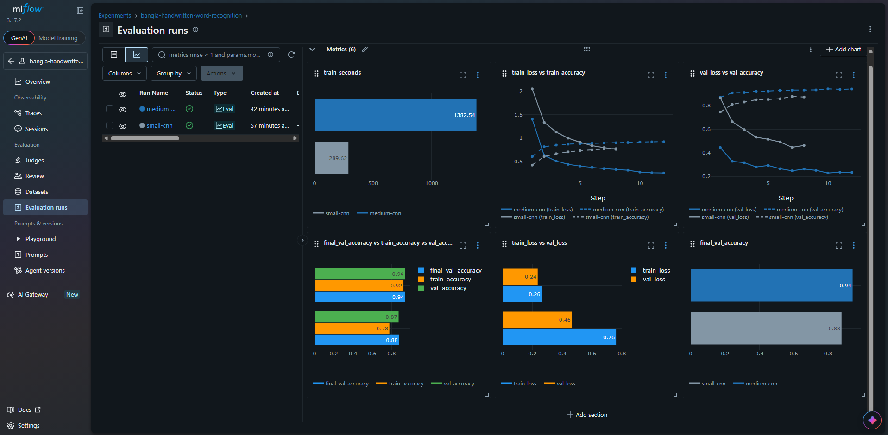
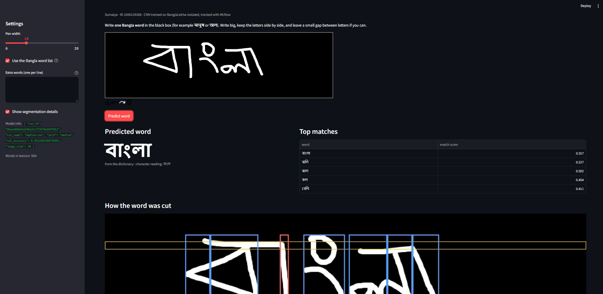

# Bangla Handwritten Word Recognition (Assignment 04)

- **Name:** Sumaiya
- **Student ID:** 1000129288
- **Course:** Skills for Industry Competitiveness and Innovation Program (SICIP), BRAC University

You draw one Bangla word in the browser and the app gives back the whole word (for example মানুষ or জল). The character model is trained on the BanglaLekha-Isolated dataset, every training run is recorded in MLflow, the interface is a Streamlit page, and the app runs in Docker.

## Approach

BanglaLekha-Isolated contains single characters, not words, so the system works in three steps.

1. **Character model (`train.py`).** A CNN is trained on the 50 basic Bangla characters (dataset folders 1 to 50: 11 vowels and 39 consonants). Every image is converted to bright ink on a dark background, cropped to the ink, padded to a square and resized to 48 x 48. During training the images are randomly rotated, shifted, zoomed, and their strokes are made thicker or thinner, so that pen strokes from the drawing canvas look familiar to the model. Two architectures are available (`--arch small` and `--arch medium`) so that runs can be compared in MLflow. The best run is saved to `models/model.keras`.
2. **Word segmentation (`bangla_common.py`).** The drawn word is cut into letters. The program finds the headline (matra), the long horizontal line on top of Bangla words, and ignores it. It then cuts the part below the headline at empty columns. Very wide pieces (letters that touch) are cut at their thinnest column. Signs written under a letter (ু ূ ৃ) are cut off at the baseline before a letter is classified. Tall, thin pieces are marked as a likely vowel bar (া, ি, ী).
3. **Whole-word decoding.** The CNN scores every piece and every group of 2 or 3 neighbouring pieces. Each word in `lexicon.txt` (about 500 common Bangla words) is turned into the shapes a person draws, for example মানুষ becomes ম, bar (া), ন, ষ, and কি becomes bar (ি), ক. A dynamic-programming alignment finds how well each word fits the pieces, and the best word is shown as the prediction. If no word fits well enough, the app joins the best characters into a word instead. You can add your own words in the sidebar or in `lexicon.txt`.

## Project structure

```
bangla-ocr-assignment/
|-- train.py               trains the CNN and records the run in MLflow
|-- app.py                 Streamlit page: draw a word, see the predicted word
|-- bangla_common.py       paths, preprocessing, segmentation, word decoder (used by both)
|-- requirements.txt
|-- Dockerfile
|-- README.md
|-- labels.json            model output index -> dataset folder -> character
|-- lexicon.txt            Bangla word list used for whole-word decoding
|-- models/
|   `-- model.keras        created by train.py
|-- artifacts/
|   `-- mlflow/            MLflow database and run files, created by train.py
`-- screenshots/
    |-- streamlit_app.png
    `-- mlflow_experiment.png
```

## How to run

Use **Python 3.10** (the version used in class). All commands are run from the project folder.

### 1. Create the environment

Linux / WSL:

```bash
python3.10 -m venv venv
source venv/bin/activate
pip install --upgrade pip
pip install -r requirements.txt
```

Windows (PowerShell):

```powershell
py -3.10 -m venv venv
venv\Scripts\activate
python -m pip install --upgrade pip
pip install -r requirements.txt
```

### 2. Get the dataset

Download BanglaLekha-Isolated from https://data.mendeley.com/datasets/hf6sf8zrkc/2 and unzip it into `data/`, so that the class folders are at `data/BanglaLekha-Isolated/Images/1`, `.../2`, and so on. The script searches for the folders named 1 to 50 under `--data-dir`, so the exact nesting does not matter. The `data/` folder is in `.gitignore` and is never pushed.

### 3. Train (two MLflow runs)

```bash
python train.py --data-dir data/BanglaLekha-Isolated --arch small  --epochs 8  --run-name small-cnn
python train.py --data-dir data/BanglaLekha-Isolated --arch medium --epochs 12 --run-name medium-cnn
```

The first run reads all images and keeps a cache in `data/cache/`, so the second run starts faster. Each run logs its parameters, per-epoch loss and accuracy, final validation accuracy, a training curve, a confusion matrix, one sample image per class, per-character accuracy and the model file. `models/model.keras` is only replaced when a run beats the best earlier run (`--always-save` overrides this).

On a laptop CPU the small model takes a few minutes per epoch and the medium model longer. For a quicker test, add `--limit-per-class 500`.

### 4. Open MLflow

```bash
mlflow ui --backend-store-uri sqlite:///artifacts/mlflow/mlflow.db --host 0.0.0.0 --port 5000
```

Open http://localhost:5000 and choose the experiment `bangla-handwritten-word-recognition`.

### 5. Run the app

```bash
streamlit run app.py
```

Open http://localhost:8501, write a word in the black box, and press **Predict word**.

### 6. Docker

Train first: the image copies `models/model.keras` into the container.

```bash
docker build -t bangla-ocr-app:0.1 .
docker run -p 8501:8501 bangla-ocr-app:0.1
```

Then open http://localhost:8501.

## Screenshots

MLflow experiment page with the two training runs:



Streamlit page showing a predicted Bangla word:



## Limitations

- The model only knows isolated characters. Whole words come from segmentation plus a word list, not from a model trained on handwritten words.
- The word list decides which full words can be returned. A word that is not in `lexicon.txt` (or in the sidebar box) can only come out as the joined character reading, which misses vowel signs other than া.
- Segmentation works best when letters are written side by side with small gaps. Letters that overlap a lot, or a slanted headline, can be cut in the wrong places.
- Vowel signs are not classified by the CNN. া ি ী are found from their shape (tall and thin), ে ৈ only through the word list, and ু ূ ৃ ঁ are ignored.
- Conjuncts (যুক্তবর্ণ) are treated as their first consonant, because the 24 compound classes of the dataset are not used.
- Canvas strokes are cleaner than scanned pen strokes, so accuracy in the app is lower than the validation accuracy in MLflow.
- The label order in `labels.json` follows the standard Bangla alphabet order of folders 1 to 50. The `one_sample_per_class.png` plot in each MLflow run can be used to check it.
